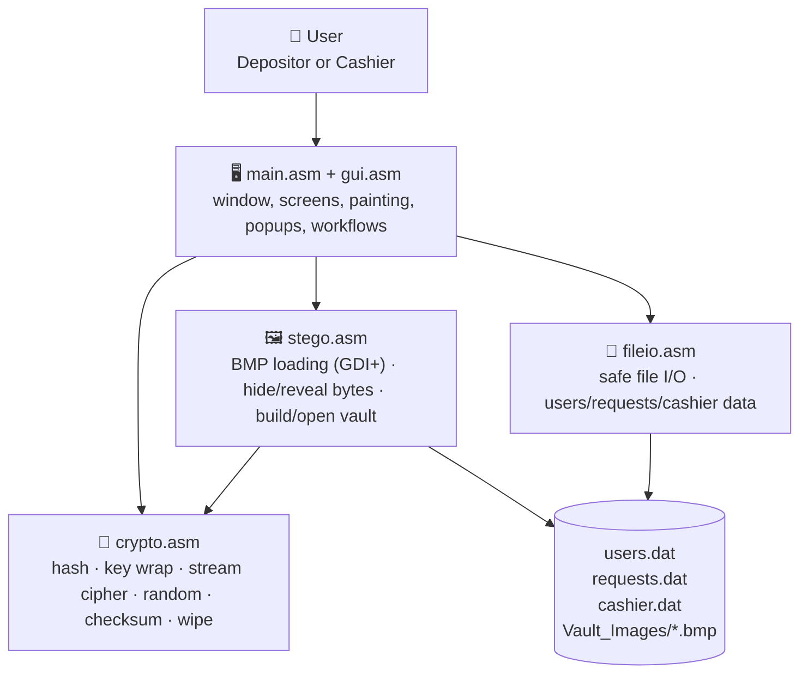
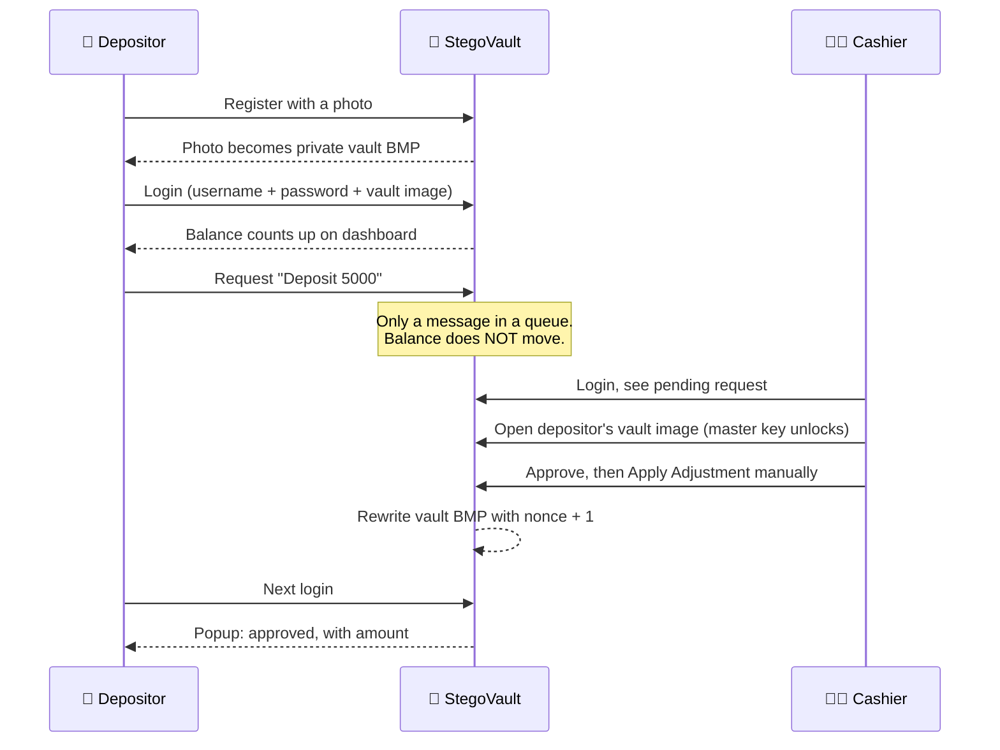

<div align="center">
# 🏦 StegoVault Bank
 
### Encrypted Steganographic Banking Vault
 
*No database. Every account is encrypted and hidden inside its owner's own picture.*
 


 
**[Overview](#-what-is-this)** ·
**[How it works](#-how-it-works)** ·
**[Features](#-features)** ·
**[Build & Run](#%EF%B8%8F-build--run)** ·
**[Demo](#-5-minute-demo-script)** ·
**[Security](#-security-design)** ·
**[FAQ](#-faq)** ·
**[Authors](#-authors)**
 
</div>
---
 
## 🔐 What is this?
 
**StegoVault Bank** is a desktop banking program written **entirely in 32-bit MASM assembly**, with a native Win32 GUI and no C runtime.
 
Its core idea: **there is no database of balances.** Each customer's name, CNIC, phone number and balance are **encrypted and hidden inside their own 24-bit BMP picture**. To open an account you need **two things**:
 
| 🧠 Something you know | 🖼️ Something you have |
|---|---|
| Your password | Your personal vault picture |
 
Either one alone is useless.
 
> ⚠️ **Educational project, not for real money.** The hash and cipher are our own teaching designs, not vetted production algorithms. See [Security Design](#-security-design).
 
---
 
## ✨ Features
 
- 🖼️ **Steganographic storage**: accounts live inside BMP pixels (1 secret bit per pixel byte, invisible to the eye)
- 🔑 **Dual-key design**: depositor and cashier can each unlock a vault without sharing passwords (DEK/KEK key wrapping)
- 🛡️ **Tamper, owner and rollback detection**: checksum, username hash, and a nonce guard
- 💾 **Crash-safe writes**: atomic file replacement via `.tmp` + `MoveFileEx`
- 🧹 **Secure wipe**: passwords and keys are zeroed from memory after use
- 🎨 **Custom vault-themed GUI**: ivory / graphite / brass, owner-drawn buttons, double-buffered painting
- 🎬 **Animations**: splash intro, hover glow, header shimmer, rotating vault dial, balance count-up
- ✅ **Live input validation**: auto-formatting CNIC, phone mask, password strength meter
---
 
## 🧩 How it works
 
### Architecture
 

 
The interface layer never does cryptography or file work itself; it calls the three worker files (**separation of concerns**).
 
### Life of a transaction
 

 
### Hiding data in pixels (LSB steganography)
 
Only the **last bit** of each colour byte changes, a difference of at most **1 out of 255**.
 
```
Data to hide: letter 'A' = 0 1 0 0 0 0 0 1
 
pixel byte before : 1011 0110   0100 1011   1100 0100 ...
secret bit        :        0          1          0   ...
pixel byte after  : 1011 0110   0100 1011   1100 0100 ...
                           ^          ^          ^
                     only this last bit is replaced
```
 
The vault stream is exactly **256 bytes**, written MSB-first into the first **2,048 bytes** of the pixel area. The 54-byte BMP header is never touched, so the picture still opens in any image viewer.
 
<details>
<summary><b>📦 Vault stream layout (256 bytes)</b></summary>
| Offset | Size | Field | Meaning |
|---|---|---|---|
| `+0x00` | 4 | Magic `"SVLT"` | Marks the picture as a StegoVault image |
| `+0x04` | 32 | UserWrappedDEK | DEK locked with the depositor's password key |
| `+0x24` | 32 | CashierWrappedDEK | DEK locked with the cashier master key |
| `+0x44` | 4 | Checksum | Tamper check (FNV hash XOR first DEK bytes) |
| `+0x48` | 32 | UsernameHash | Hash of the owner's username |
| `+0x68` | 4 | Nonce | Version counter, +1 on every rewrite |
| `+0x6C` | 148 | EncryptedRecord | The account itself, encrypted |
 
**Account record (148 bytes, before encryption):** account number (16), full name (64), username (32), CNIC (16), contact (16), balance (4).
 
</details>
---
 
## 👥 Two kinds of users
 
| 🧑 Depositor (customer) | 🧑‍💼 Cashier (bank employee) |
|---|---|
| Registers with a photo | Creates their own account on first start (no built-in admin) |
| Logs in with username + password + vault image | Sees pending requests and registered vault pictures |
| Views balance, sends deposit/withdraw requests | Unlocks a vault with the master key |
| Gets popups about decided requests | Approves / rejects, then applies the amount by hand |
 
---
 
## 🛠️ Build & Run
 
### Requirements
- Windows with **MASM32** (`ml.exe`, `link.exe`)
- A terminal such as the VS Code terminal opened in the project folder
### Build
 
```bat
.\build.bat clean
.\build.bat
```
 
> 💡 `clean` deletes `main.exe`, so always build again after it.
 
### Run
 
```bat
.\main.exe
```
 
### Reset for a fresh demo
 
```bat
reset_data.bat
```
 
Deletes `users.dat`, `requests.dat` and the vault pictures, but **keeps** `cashier.dat`.
 
---
 
## 📂 Project structure
 
| File | Lines | Job |
|---|---|---|
| `main.asm` | ~590 | Entry point, window creation, message loop, background painting, resize |
| `gui.asm` | ~6,360 | All screens, drawing, animation, popups, validation, workflows |
| `crypto.asm` | ~615 | Hash, random, key wrapping, stream cipher, checksum, wipe |
| `stego.asm` | ~915 | GDI+ image loading, hide/reveal bytes, build/open vault images |
| `fileio.asm` | ~1,100 | Safe file I/O, the three data files, folder scanning |
| `constants.inc` | ~385 | Named numbers: sizes, colours, error codes, control IDs |
| `structs.inc` | ~185 | Record and Windows structure layouts |
| `protos.inc` | ~380 | Procedure prototypes shared across files |
| `build.bat` | 30 | Assembles and links everything into `main.exe` |
 
<details>
<summary><b>🗃️ Data files on disk</b></summary>
| File | Record size | Stores |
|---|---|---|
| `users.dat` | 96 bytes | Username (lowercase), salt (16), verifier (32), LastNonce (4) |
| `requests.dat` | 64 bytes | Username, account number, type (1 deposit / 2 withdraw), amount, status (0 pending / 1 approved / 2 rejected), notified flag |
| `cashier.dat` | 80 bytes | Cashier username, salt, verifier |
| `Vault_Images\<name>.bmp` | varies | One depositor's hidden, encrypted account |
 
Fixed-length records let the program jump straight to record `N` at offset `N × size` with `SetFilePointer`.
 
</details>
<details>
<summary><b>🚨 Error codes</b></summary>
| Code | Name | Meaning |
|---|---|---|
| 1 | `SV_ERR_IO` | File could not be read or written |
| 2 | `SV_ERR_MEM` | Out of memory |
| 3 | `SV_ERR_BMP` | Not a valid 24-bit BMP |
| 4 | `SV_ERR_CAPACITY` | Picture too small to hold the vault |
| 5 | `SV_ERR_MAGIC` | Valid picture but no SVLT vault data |
| 6 | `SV_ERR_NOT_OWNER` | Image belongs to a different user |
| 7 | `SV_ERR_CHECKSUM` | Wrong key or data was tampered with |
| 8 | `SV_ERR_AUTH` | Wrong login |
| 10 | `SV_ERR_FUNDS` | Not enough balance |
| 11 | `SV_ERR_INPUT` | Invalid input |
| 12 | `SV_ERR_STALE` | Old copy of the image |
 
</details>
---
 
## 🔒 Security design
 
### ✅ What is strong
 
- No plaintext passwords or balances on disk, only salted verifiers and encrypted pictures
- Two-factor access: password + personal image
- Dual-key design lets the cashier help without knowing the password
- Tamper detection, wrong-owner detection and rollback detection
- Atomic writes and secrets wiped from memory after use
### ⚠️ Honest limitations
 
- The hash (`SvHash256`) and cipher (`SvCipher`) are **our own educational constructions**, not vetted algorithms. Real systems use SHA-256 / AES / bcrypt.
- The cashier master key is a **constant inside the program**, so a reverse engineer could extract it.
- The rollback guard fails if both the image **and** `users.dat` are restored together.
- LSB data is destroyed if the image is re-saved as JPG or resized, so vault images must stay **BMP**.
- **Not meant for real money.**
<details>
<summary><b>🔑 Concepts used (click to expand)</b></summary>
| Concept | Role in the project |
|---|---|
| **Salt** | Random value so equal passwords get different verifiers |
| **Verifier** | `hash("AUTH" + salt + password)`, stored instead of the password |
| **DEK** | 32-byte random key that encrypts the account record |
| **KEK** | Key that locks the DEK (one from password, one from cashier master key) |
| **Stream cipher** | Two-pass keystream cipher over the 148-byte record |
| **Nonce** | Counter that changes the keystream and detects old copies |
| **FNV-1a checksum** | Detects any flipped bit |
| **Atomic write** | Write to `.tmp`, then swap in with `MoveFileExA` |
| **Secure wipe** | Zero out buffers after use (`SvWipe`) |
 
</details>
---
 
## 🎬 5-minute demo script
 
1. Start the program: splash animation, then the full-screen login
2. **Cashier tab**: create the cashier account, then log in (empty request list)
3. Log out, **Register** a depositor with a big colourful photo and an initial deposit (watch the CNIC dashes and strength bar)
4. Open the new file in `Vault_Images`. It looks like a normal picture
5. Log in as the depositor: balance counts up. Submit a deposit request, log out
6. **Cashier**: log in, select the depositor, insert the BMP from `Vault_Images`, choose *Update balance*, **Approve**, choose *Deposit*, enter the amount, **Apply**
7. Depositor again: popups show *approved* and the amount, and the balance is updated
8. **Security demo**: try another user's image (*Unauthorized Image*), then flip a bit in a hex editor (*tamper message*)
---
 
## 🖥️ GUI at a glance
 
| Screen | What it does |
|---|---|
| **Login** | Depositor / Cashier tabs |
| **Register** | Form with live strength meter and input masks |
| **Depositor Dashboard** | Profile, animated vault card, request panel |
| **Cashier Panel** | Pending requests, vault list, details and balance update |
 
**Theme:** ivory `#F5F2EB` · graphite `#18232E` · brass `#B8935A` · slate `#2F3E4D`
**Window:** resizable, minimum 960 × 640, opens maximized, content stays centred.
 
<!-- 📸 Add screenshots here:


-->
 
---
 
## ❓ FAQ
 
<details>
<summary><b>Why assembly?</b></summary>
To understand how a program really runs: registers, stack, memory and the Windows API, with no runtime hiding anything.
</details>
<details>
<summary><b>Is this encryption or steganography?</b></summary>
Both. The record is encrypted first, then hidden in the pixels. Encryption hides the <i>meaning</i>; steganography hides that anything <i>exists</i>.
</details>
<details>
<summary><b>Why does the picture look unchanged?</b></summary>
Only the last bit of each colour byte changes, a difference of 1 out of 255.
</details>
<details>
<summary><b>Why BMP and not JPG?</b></summary>
BMP is lossless. JPG compression would destroy the hidden bits.
</details>
<details>
<summary><b>How is a password checked without storing it?</b></summary>
We store <code>hash("AUTH" + salt + password)</code> and compare it with the recomputed value at login.
</details>
<details>
<summary><b>What stops someone using another person's image?</b></summary>
The header stores a hash of the owner's username. A mismatch gives <i>Unauthorized Image</i>.
</details>
<details>
<summary><b>What stops an old image from being reused?</b></summary>
The nonce inside the image must be at least the <code>LastNonce</code> saved in <code>users.dat</code>.
</details>
<details>
<summary><b>What would you improve?</b></summary>
Use standard AES and SHA-256, keep the master key outside the program, and add audit logs.
</details>
---
 
## 👨‍💻 Authors
 
<table>
  <tr>
    <td align="center">
      <a href="https://github.com/Moazamuddin12">
        <br/>
        <b>Moazamuddin</b>
      </a><br/>
      <br/><b>🎖️ Project Leader</b><br/>
      <sub>GUI · Workflows · File Handling · Demo</sub>
    </td>
    <td align="center">
      <a href="https://github.com/fahad-ul-islam">
        <br/>
        <b>Fahad ul Islam</b>
      </a><br/>
      <br/><b>🤝 Project Partner</b><br/>
      <sub>Cryptography · Steganography · File Handling</sub>
    </td>
  </tr>
</table>
FAST-NUCES Karachi · Computer Organization & Assembly Language
 
---
 
<div align="center">
*Built with registers, stacks and a lot of bits.* 🔐
 
</div>
 
